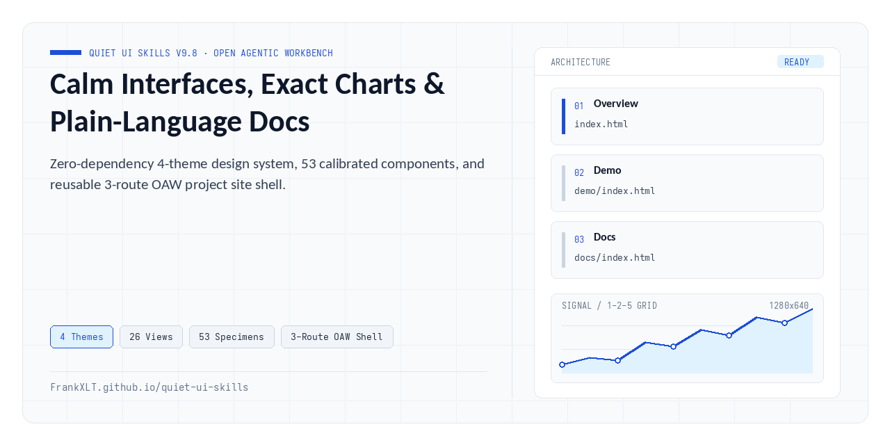

# Quiet User Interface Skills (v9.8.0)

[](https://github.com/FrankXLT/quiet-ui-skills/actions/workflows/ci.yml)
[](LICENSE)
[](customizations/LICENSE)
[](https://FrankXLT.github.io/quiet-ui-skills/)

**Quiet User Interface Skills** is a zero-dependency design system, deterministic chart and schematic compiler, plain-language communication framework, and reusable three-route project-site shell for developers and AI coding agents.



---

## Quick Navigation & Live Three-Route Hub

Explore Quiet User Interface Skills online at [**https://FrankXLT.github.io/quiet-ui-skills/**](https://FrankXLT.github.io/quiet-ui-skills/) or open any compiled surface directly from the repository with zero build steps or external CDNs:

| Surface | Local Path | What You Will Find |
| :--- | :--- | :--- |
| **Overview** | [`docs/index.html`](docs/index.html) | Plain-language landing page, copyable install commands, 6-domain cards, and architecture flow diagram. |
| **Interactive Demo** | [`docs/demo/index.html`](docs/demo/index.html) | **26 Views · 6 Domains** across clinical, cloud/AI, grid telemetry, civic briefs, aero/auto, and smart-home consoles. |
| **Plain-Language Docs** | [`docs/docs/index.html`](docs/docs/index.html) | Searchable two-column Markdown reader with section outlines, quick jumps, and inline vector diagrams. |
| **Component Library** | [`docs/bench/evidence-bench.html`](docs/bench/evidence-bench.html) | **53 Compiled Specimens** covering calibrated SVG plots, Apache ECharts, civic maps, forms, alarms, and schematics. |
| **Standalone Studio** | [`quiet-ui-showcase.html`](quiet-ui-showcase.html) | Single-file offline 26-view showcase ready to open directly in any browser. |

> **Deep-link any view or theme:** Append `?domain=06-smart-home-and-energy&view=v18-home-assistant-companion-console&theme=white` or `?mode=components&theme=dark` to open a specific domain view, specimen library, or color theme directly. For full agent rules and engineering workflows, read [`AGENTS.md`](AGENTS.md) and [`docs/WORKFLOWS.md`](docs/WORKFLOWS.md).

---

## What Quiet User Interface Skills Solves

- **Calm, zero-clutter screens across 4 themes ([`quiet-ui`](skills/quiet-ui/SKILL.md)):** Replaces ad-hoc styling with clear reading widths, accessible form validation, resilient empty states, an `11px` legibility floor, and one shared token stylesheet ([`tokens/quiet-ui-tokens.css`](tokens/quiet-ui-tokens.css)) that switches smoothly across **Pure White** (`white`), **Warm Paper** (`paper`), **Dark Paper** (`dark-paper`), and **Dark** (`dark`).
- **Exact, calibrated SVG & ECharts visuals ([`quiet-evidence`](skills/quiet-evidence/SKILL.md)):** Stops AI agents from guessing SVG coordinates freehand. Structured JSON compiles deterministically into `1–2–5` scaled charts, waveforms, hardware bitfields, US hex maps, slopegraphs, and clean-room systems diagrams—with explicit units, visible missing-data gaps, `Chart | Table` toggles, and `Copy for AI`.
- **Plain-language framing with conserved numbers ([`quiet-bridge`](skills/quiet-bridge/SKILL.md)):** Explains the same verified facts clearly for executive summaries, engineering deep-dives, and hands-on operator guides so sample counts, units, limits, and timestamps stay identical across every screen and printout.
- **Automated layout, contrast & drift checking (`audit_quiet_html.py`):** Scans HTML, CSS, and JS offline—plus optional live Headless Chrome sweeps across `390px`, `820px`, and `1440px`—to catch `!important` overrides, sub-`11px` text, clipped SVG labels, unlabeled controls, dead-end zero states, and raw color drift (`--strict-drift`, persisted in `.quiet-ui.md`).

---

## 60-Second Brand Customization & Reusable OAW Project-Site Shell

One JSON manifest skins both your application chrome and compiled charts, or spins up a static three-route website for any Open Agentic Workbench (OAW) repository. Never edit read-only starters or `skills/` directly—copy a starter into your own folder first (see [`customizations/README.md`](customizations/README.md) and [`customizations/project-site-starter/README.md`](customizations/project-site-starter/README.md)):

| MIT Starter Kit | Scope | Best For |
| :--- | :---: | :--- |
| **`customizations/brand-starter/`** | **22 Views** (Domains `01–05`) | SaaS portals, enterprise dashboards, engineering documentation, and public data briefs. |
| **`customizations/personal-starter/`** | **26 Views** (All 6 domains + 8 CC0/PD photos) | Personal research workbenches, ambient displays, optical HUDs, and smart-home consoles. |
| **`customizations/project-site-starter/`** | **3-Route OAW Site Shell** (`oaw-site.json`) | Open-source repositories needing `Overview`, optional `Demo` wrapper, searchable `Docs`, and `1280x640` social cards. |

```bash
# 1. Build a reusable 3-route OAW project site + 1280x640 SVG/PNG social preview
cp -r customizations/project-site-starter customizations/my-site
python3 -B customizations/scripts/build_project_site.py \
  --config customizations/my-site/oaw-site.json \
  --out dist/my-site \
  --social-png

# 2. Or skin a 22-view brand / 26-view personal showcase and verify WCAG contrast
cp -r customizations/brand-starter customizations/my-brand
python3 -B customizations/scripts/build_showcase.py customizations/my-brand
python3 -B customizations/scripts/verify_customization.py customizations/my-brand --check-immutability
```

You can also hand an AI agent 1–3 visual references plus `--accent-primary`, `--accent-focal`, and `--font-sans` values to clone a starter, update `styles/overrides.css` inside `@layer tokens`, and verify the compiled build automatically.

---

## Install & Verify

Quiet UI runs on pure Python (`>= 3.10`) with zero runtime dependencies. Install the native Antigravity plugin (`~/.gemini/config/plugins/quiet-ui-skills`) and portable skills (`~/.agents/skills/{quiet-ui,quiet-evidence,quiet-bridge}`) for Claude Code, Cursor, Codex, and Windsurf:

```bash
# Clone and install the native plugin + all 3 portable skills
git clone https://github.com/FrankXLT/quiet-ui-skills.git && cd quiet-ui-skills && ./install.sh

# Or install individual pillars via the Skills CLI
npx skills add https://github.com/FrankXLT/quiet-ui-skills --skill quiet-ui
npx skills add https://github.com/FrankXLT/quiet-ui-skills --skill quiet-evidence
npx skills add https://github.com/FrankXLT/quiet-ui-skills --skill quiet-bridge
```

Rebuild derived outputs, run the test suite, audit any generated HTML/CSS, and launch the local three-route preview server:

```bash
# 1. Rebuild derived mirrors, bundles, Component Library (53 specimens), Studio (26 views) & starters
python3 -B scripts/build_all.py

# 2. Run zero-dependency tests (set QUIET_REQUIRE_CDP=1 for full Chrome CDP visual gates)
python3 -B -m unittest discover -s tests -v

# 3. Audit generated pages or your own app against token drift and layout rules
python3 -B skills/quiet-ui/scripts/audit_quiet_html.py path/to/web --strict-drift

# 4. Preview the local 3-route hub (Overview, /demo/, /docs/, /bench/) on port 8788
python3 -B scripts/serve_showcase.py --port 8788
```

---

## Three-Pillar Architecture & Repository Map

| What You Need | Pillar | Deterministic Output |
| :--- | :---: | :--- |
| **Pages, dashboards, print briefs, wall kiosks, or HUDs** | [`quiet-ui`](skills/quiet-ui/SKILL.md) | 7 mediums (`M1–M7`), `N0–N4` shells, 4-theme tokens, accessible forms, 4-way empty states, and `audit_quiet_html.py`. |
| **Plots, waveforms, bitfields, maps, or schematics** | [`quiet-evidence`](skills/quiet-evidence/SKILL.md) | Pure-Python/JS compilers (`1–2–5` ticks, `QuietSvgLayout`, `QuietEChartsDefaults`, `sequence`, `n2_matrix`, `fault_tree`, `pid`, `er_lineage`). |
| **Executive memos, lab reports, or operator guides** | [`quiet-bridge`](skills/quiet-bridge/SKILL.md) | 7 audience lenses, 3 decision tempos, `L1–L3` rigor, `.quiet-ui.md` intake memory, and cross-artifact numerical conservation. |

```text
quiet-ui-skills/
├── AGENTS.md / docs/WORKFLOWS.md      # Agent build contracts & WF-01..WF-10 workflows
├── plugin.json / install.sh           # Native Antigravity plugin (v9.8.0) & cross-agent installer
├── quiet-ui-showcase.html             # Standalone 26-view interactive studio
├── tokens/quiet-ui-tokens.css         # Canonical 4-theme CSS design tokens (MIT)
├── skills/
│   ├── quiet-ui/                      # Pillar 1: 7 mediums, foundation guides & audit_quiet_html.py
│   ├── quiet-evidence/                # Pillar 2: Calibrated compilers, CJK-safe QuietSvgLayout & bundle
│   └── quiet-bridge/                  # Pillar 3: Audience lenses, tempos & review protocols
├── customizations/                    # MIT brand-starter, personal-starter & project-site-starter
├── src/                               # CSS layers, JS runtime, 26-view generators & OAW site_shell
├── scripts/                           # build_all.py, build_social_preview.py, serve_showcase.py
├── docs/                              # Published hub (index.html, demo/, docs/, bench/, assets/)
└── tests/                             # Zero-dep stdlib, corpora, hygiene & optional Chrome CDP gates
```

---

## Licensing Boundary & Search Topics

- **Core Engine (`Apache-2.0`, [`LICENSE`](LICENSE)):** Covers `plugin.json`, `skills/quiet-ui/`, `skills/quiet-evidence/`, `skills/quiet-bridge/`, deterministic compilers, layout auditors, and site builders ([`NOTICE`](NOTICE), [`TRADEMARKS.md`](TRADEMARKS.md)). All runtime code is 100% first-party with zero third-party dependencies ([`THIRD_PARTY_LICENSES.md`](THIRD_PARTY_LICENSES.md)).
- **Tokens, Customizations & Generated Output (`MIT`, [`customizations/LICENSE`](customizations/LICENSE)):** Covers `tokens/quiet-ui-tokens.css`, everything inside `customizations/`, and **100% of HTML, CSS, JS, SVG, and PNG deliverables** you generate—yours to ship commercially with zero `NOTICE` or attribution obligations.

**GitHub Topics:** `design-system` · `agent-skills` · `ai-coding-agents` · `css-tokens` · `svg-charts` · `echarts` · `data-visualization` · `accessibility` · `wcag` · `static-site-generator` · `documentation-generator` · `zero-dependencies` · `quiet-ui`
