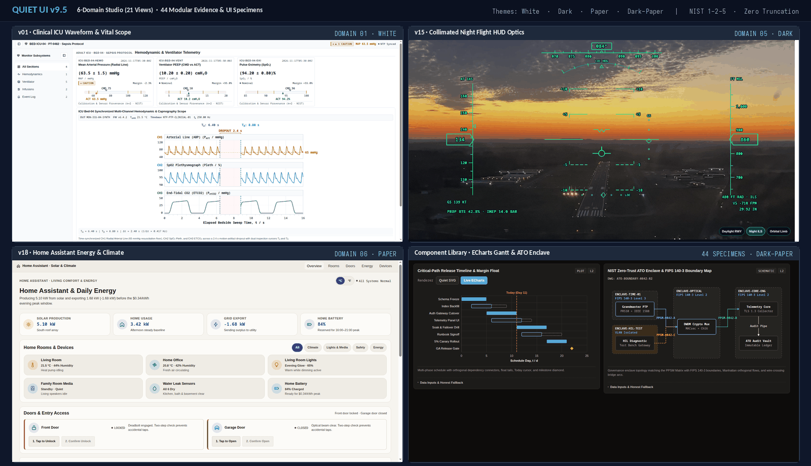

# Quiet UI Skills (`v9.6.0`)

[](https://github.com/FrankXLT/quiet-ui-skills/actions/workflows/ci.yml)
[](LICENSE)
[](customizations/LICENSE)
[](https://FrankXLT.github.io/quiet-ui-skills/)

**Quiet UI Skills** is a 100% first-party, zero-dependency design system and deterministic engineering UI/SVG compiler suite for AI coding agents (Google Antigravity, Claude Code, Cursor, Codex, and Windsurf). It unifies **7 physical delivery mediums (`M1–M7`)**, **6 quantitative evidence modalities (`M1–M6`)**, and **audience communication vectors (`L1–L3`)** under one 4-theme design token contract (`11px` hard floor) and a 60-second brand customization workflow:

1. **`quiet-ui` (7 Delivery Mediums, `.quiet-ui.md` Contract & Forms/Zero-States):** Adapts typography, container spacing, and chrome physics across `M1`–`M7` (`.va-stage[data-width="reading|workbench"]`, `data-stage="canvas|workbench|ops"`, bordered `.va-toolbar-joined`), persists project scope in `.quiet-ui.md`, codifies accessible forms, 4-way zero-states, and `>= 7s` undo toasts (`foundation/forms-states-and-resilience.md`), and ships the portable zero-dependency linter (`audit_quiet_html.py` + `audit_ux_and_drift.py` + `audit_workbench_probes.py`) enforcing `--strict-drift`, deprecation blocklists, unlabeled controls, and CDP SVG/workbench/truncation bounds across `390px`, `820px`, `1440px`, and `1920px`.
2. **`quiet-evidence` (Metrology, Clean-Room SVG Compilers & CJK-Safe `QuietSvgLayout`):** Deterministically compiles calibrated waveforms, analytical & calibration plots, cyclical Min–Avg–Max whiskers (`buildCyclicalWhiskerOption`), waterfalls, 32/64-bit hardware bitfields, tabular ledgers, and clean-room systems schematics—with East-Asian wide (`1.75x`) & combining-mark gutter math (`visual_char_units` / `QuietSvgLayout.visualUnits`) across SVG and ECharts.
3. **`quiet-bridge` (Audience Translation & Plain-English Rationale):** Translates dense multi-domain instrumentation across expert, executive, and learner audiences with verifiable data conservation, persistent `.quiet-ui.md` intake memory, and explicit `Warming up — N samples collected` disclosures on thin buffers.



---

## Quick Start & Installation

- **Live v9.6 Interactive Studio (`6 Domains · 22 Views`):** [**https://FrankXLT.github.io/quiet-ui-skills/**](https://FrankXLT.github.io/quiet-ui-skills/) — or open [`quiet-ui-showcase.html`](quiet-ui-showcase.html) locally (zero build step, zero external CDNs).
- **3-Pillar Component Library (`49 Compiled Specimens`):** Open [`docs/bench/evidence-bench.html`](docs/bench/evidence-bench.html) locally or switch to the **Components** tab in the studio bar to inspect UI controls, KPI gauges, US 51-hex tile maps, ranked directional arrow dumbbells, paired subgroup bars, dual count/% slopegraphs, diverging %/$ tables (`Chart | Table` & `Copy for AI`), forms & zero-states, systems schematics, and decision bridges.
- **Agent Onboarding (`AGENTS.md` / `CLAUDE.md`):** Read [`AGENTS.md`](AGENTS.md) for single-command rebuilds (`scripts/build_all.py`), portable auditor usage (`audit_quiet_html.py`), and repository invariants.
- **Deep-Link Any State:** Append `?mode=examples&domain=06-smart-home-and-energy&view=v18-home-assistant-companion-console&theme=white` or `?mode=components&theme=dark` to share an exact domain view, component library tab, or surface theme.

```bash
# Install native Antigravity Plugin (~/.gemini/config/plugins/quiet-ui-skills)
# plus cross-agent skills (~/.agents/skills/{quiet-ui,quiet-evidence,quiet-bridge})
git clone https://github.com/FrankXLT/quiet-ui-skills.git
cd quiet-ui-skills
./install.sh

# Or install individual pillars via the Skills CLI
npx skills add https://github.com/FrankXLT/quiet-ui-skills --skill quiet-ui
npx skills add https://github.com/FrankXLT/quiet-ui-skills --skill quiet-evidence
npx skills add https://github.com/FrankXLT/quiet-ui-skills --skill quiet-bridge
```

---

## Customize in 60 Seconds (`customizations/`)

One manifest (`customizations/<name>/customization.json`) skins **both** your UI shells and your compiled SVG/ECharts schematics simultaneously:

| Starter Blueprint | Scope | Enabled Views | Optical & Gallery Backplates | Target Use Cases |
| :--- | :---: | :---: | :---: | :--- |
| **`personal-starter`** | Personal & Spatial | All **22 Views** (6 Domains) | All 7 PD/CC0 & NASA photos | Personal research briefs, telemetry consoles, Home Assistant walls, optical HUDs, maritime glass. |
| **`brand-starter`** | Team & Product | **18 Views** (Domains 01–05) | Omitted | Enterprise software products, SaaS dashboards, public data briefs & systems schematics. |

```text
I want to customize Quiet UI for [personal / brand] use in customizations/<my-name>/.
Here are 1–3 inspirational design references:
- Reference 1: [URL, screenshot, or design link]
Brand Hexes / Fonts:
- Primary Accent: #... | Surface / Canvas: #FFFFFF / #F8FAFC
- Typography: [Sans font] / [Serif font] / [Mono font]

Please clone the starter, extract design tokens into customization.json, update styles/overrides.css, and compile/verify the showcase.
```

---

## 3-Pillar Architecture: `quiet-ui` + `quiet-evidence` + `quiet-bridge`

| What You Hand the Agent | Activated Pillar | What It Builds Deterministically |
| :--- | :---: | :--- |
| **Long-form monographs, RFCs, runbooks, fleet grids, planners, walls, or HUDs** | `quiet-ui` | Unboxed `72ch` sheets (`M1`), responsive editorial grids (`M2`), stateful apps (`M3`), POI terminals (`M4`), `>= 32px` wall displays (`M5`), `>= 65%` keep-out HUDs (`M6`), smoked-glass overlays (`M7`) |
| **Waveforms, spectral/calibration plots, waterfalls, HA energy bars, or tables** | `quiet-evidence` | JSON-compiled `plot_compiler.py` (`1–2–5` ticks, residual strips), `echarts_adapter.py`, `waveform_compiler.py`, `comparison_plots.py`, `scalar_and_table.py`, and `bitfield_compiler.py` |
| **Sequence flows, $N^2$ matrices, fault trees, P&IDs, buses, or ER schemas** | `quiet-evidence` | Clean-room open-standards SVG compilers: `sequence` (`ITU-T Z.120`), `n2_matrix` (`NASA SP-2016-6105`), `fault_tree` (`NRC NUREG-0492`), `pid`, `bus`, `pipeline`, `interlock`, `er_lineage` |
| **Executive memos, lab reports, clinical handoffs, or multi-level explanations** | `quiet-bridge` | Audience vector selection (`L1` / `L2` / `L3`), dual-layer briefing + proof stage, `.quiet-ui.md` contract persistence, and cross-artifact numerical conservation checks |

---

## 1. `quiet-ui`: 7 Delivery Mediums & Continuum Archetypes

All 7 delivery mediums (`M1–M7`) and all 22 domain views default to **Pure White (`data-theme="white"`)** and switch live across **Warm Paper (`paper`)**, **Warm Sepia Dark (`dark-paper`)**, and **Carbon Dark (`dark`)**:

| # | Tier ID | Structural Archetype | Box Weight | Default Nav | Primary Use Cases |
| :-: | :--- | :--- | :---: | :---: | :--- |
| `01` | **`Doc-1`** | Academic & Scientific Monograph | `0%` | `N1` Left Spine | Whitepapers, mathematical derivations, research monographs |
| `02` | **`Doc-2`** | Executive Decision Memo (`BLUF` + Diagram) | `15%` | `N0` Kiosk | Architecture decision records, board memos, post-mortems |
| `03` | **`Doc-3`** | Normative RFC Specification | `25%` | `N0` Kiosk | Protocol specs, `MUST`/`SHALL` compliance matrices, state machines |
| `04` | **`Doc-4B`** | Encyclopedic SDK & API Reference | `25%` | `N3` Top + Left | Library SDK references, CLI/skill docs, decision router tables |
| `05` | **`Doc-4A`** | Split-Pane Operational Runbook | `45%` | `N1` Left Spine | Deployment playbooks, incident response SOPs, interactive tutorials |
| `06` | **`Bridge-1`** | Parametric Engineering Worksheet | `50%` | `N0` Kiosk | Interactive trade studies, link-budget calculators, solver sheets |
| `07` | **`Deck-1`** | Viewport-Locked Briefing Stage | `60%` | `N1` Left Spine | `100dvh` 16:9 assertion-evidence briefings with zero vertical scroll |
| `08` | **`Bridge-2`** | High-Density Data Table & Fleet Grid | `100% 1px Grid` | `N2` Top Bar | Container fleet inventories, node ledgers, benchmark matrices |
| `09` | **`App-2`** | Live Metrics & HIL Console | `100% 1px Grid` | `N1` Left Spine | Synchronized strip charts, subsystem rankings, threshold gauges |
| `10` | **`App-1`** | Compact Issue & Ticket Tracker | `0% Cards` | `N1` Left Spine | `36px` single-line triage queues with docked right inspector |
| `11` | **`App-4`** | Task & Calendar Planner | `80%` | `N1` Left Spine | Daily status briefing, focus timer hero, backlog staging, time grid |
| `12` | **`App-3`** | KPI & Analytics Dashboard (Bento Grid) | `100% Cards` | `N2` Top Bar | 12-column executive KPI grid and balanced 2×2 `.va-bento-2col` |
| `13` | **`App-5`** | Daily Pacing & Workload Planner | `75%` | `N1` Left Spine | Readiness ring, self-filling progress capsules, corridor sparklines |
| `14` | **`App-Tree`** | Hierarchical Tree, Schema & File Explorer | `90% 3-Pane` | `N1` Left Spine | Coupled object tree, 3-tab table/DDL/AST stage, and FK inspector |
| `15` | **`HUD-1`** | Optical Viewport / AR HUD | `20% HUD` | `N0` Kiosk | `>= 65%` open optical sightline + smoked-glass `.va-hud-pod` cards |
| `16` | **`Ctrl-1`** | Tactile Subsystem Console | `85%` | `N1` Zone Rail | Walk-up touch console with 2-step guarded effector controls (`ARM` $\rightarrow$ `EXECUTE`) |

---

## Verification Toolchain & Repository Layout

```bash
# 1. Regenerate all derived artifacts & verify zero-drift sync
python3 -B scripts/build_all.py
python3 -B scripts/build_all.py --check

# 2. Run zero-dependency suite (compilers, 204 corpus checks, portability, hygiene)
QUIET_SKIP_CDP=1 python3 -B -m unittest discover -s tests -v

# 3. Run full Headless Chrome CDP visual gates (requires selenium + pillow)
QUIET_REQUIRE_CDP=1 python3 -B -m unittest discover -s tests -v

# 4. Run the portable Quiet UI HTML/CSS & CDP linter on any deliverable
python3 -B skills/quiet-ui/scripts/audit_quiet_html.py quiet-ui-showcase.html --cdp --allow-showcase-chrome
python3 -B skills/quiet-ui/scripts/audit_quiet_html.py path/to/app/web --context path/to/app/.quiet-ui.md --strict-drift
```

```text
quiet-ui-skills/
├── AGENTS.md / CLAUDE.md                          # Agent-native build, test & invariant contracts
├── plugin.json                                      # Native Antigravity plugin manifest (v9.6.0)
├── pyproject.toml                                   # PEP 621 zero-runtime-dep metadata & [dev] extras
├── quiet-ui-showcase.html                           # Unified 6-domain 22-view Quiet UI v9.6 Studio
├── assets/logo.svg                                  # High-contrast square plugin icon
├── LICENSE / NOTICE / TRADEMARKS.md                 # Apache 2.0 Core 3-Pillar + MIT Customizations & Output
├── THIRD_PARTY_LICENSES.md                          # Clean-room zero third-party runtime & Apache ECharts license notice
├── install.sh                                       # 1-command plugin & 3-pillar cross-agent installer
├── tokens/quiet-ui-tokens.css                       # Standalone 4-theme CSS design tokens (MIT)
├── src/                                             # Flattened CSS (00–17), JS runtime & 22-view generators
├── scripts/                                         # Canonical builders (build_all.py, build_showcase.py, serve_showcase.py)
├── tests/                                           # Unified stdlib & Chrome CDP visual regression suite
├── docs/index.html                                  # GitHub Pages mirror of quiet-ui-showcase.html
├── docs/bench/evidence-bench.html                   # 49-specimen deterministic 3-Pillar Component Library
├── customizations/                                  # Personal (22-view) & Brand (18-view) starter kits (MIT)
└── skills/
    ├── quiet-ui/                                    # Pillar 1: 7 mediums, forms/zero-states, .quiet-ui.md & audit_quiet_html.py
    ├── quiet-evidence/                              # Pillar 2: Calibrated compilers, portable assets & CJK-safe QuietSvgLayout
    └── quiet-bridge/                                # Pillar 3: Audience translation & persistent intake protocol
```

---

## Licensing & Provenance

- **100% First-Party Core Engine (`Apache-2.0`):** Covers `plugin.json`, `skills/quiet-ui/`, `skills/quiet-evidence/`, `skills/quiet-bridge/`, deterministic compilers, verifiers, and showcases (`LICENSE`, `NOTICE`, `TRADEMARKS.md`).
- **Zero Third-Party Code Dependencies:** Every SVG schematic, plot, icon glyph, and CSS token in v9.6 is clean-room first-party code implementing open engineering standards (`THIRD_PARTY_LICENSES.md`).
- **Customizations, Tokens & 100% Commercial Output Exemption (`MIT`):** All files in `customizations/`, `tokens/quiet-ui-tokens.css`, and 100% of HTML, CSS, JS, SVG, and PNG deliverables generated with Quiet UI Skills belong to you under pure MIT with **zero `NOTICE` or attribution obligations** on shipped websites, apps, or decks.
