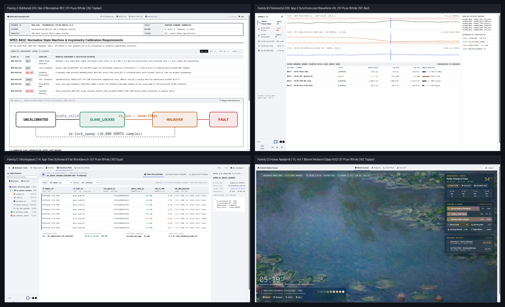
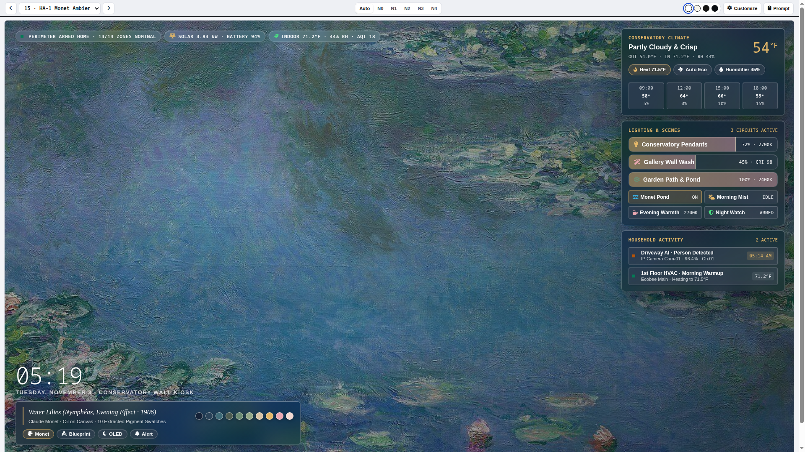
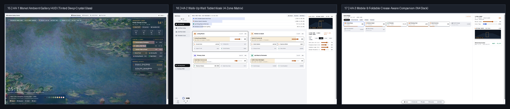
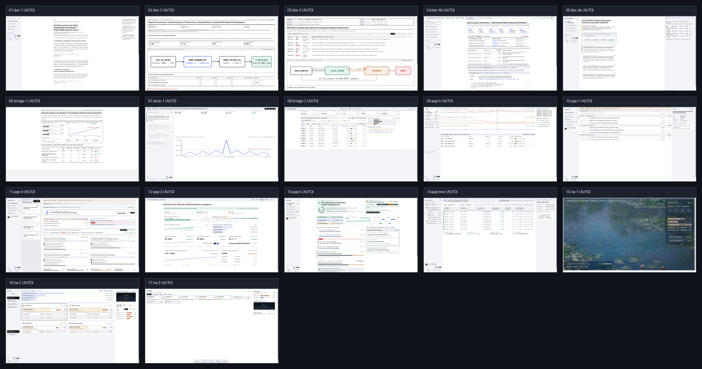

# Quiet UI (`visual-architecture-system`)

[](LICENSE)
[](tokens/quiet-ui-tokens.css)
[](https://FrankXLT.github.io/quiet-ui-skills/)

**Quiet UI (`visual-architecture-system`)** is an open-source skill and CSS design-token system for AI coding agents that turns raw prose, technical specifications, SQL schemas, fleet inventories, and smart-home entities into cohesive, responsive HTML interfaces. Instead of defaulting every prompt to a generic dark-mode Bento dashboard, it routes content across **17 graduated structural archetypes** (`0%` unboxed monograph prose up to `100%` hairline telemetry grids and spatial wall panels) that share one typographic scale, four surface themes, and mathematically verified layout geometry.



---

## Quick Start & Live Showcase

- **Interactive 17-Tier Showcase:** [**https://FrankXLT.github.io/quiet-ui-skills/**](https://FrankXLT.github.io/quiet-ui-skills/) (or open [`quiet-ui-showcase.html`](quiet-ui-showcase.html) locally — zero build step or server required).
- **Deep-Link Any State:** Append query parameters such as `?tier=app-3&nav=n2&theme=white&density=d2&corners=rounded` to share an exact archetype, navigation shell, surface theme, and corner geometry.

```bash
# Install into ~/.agents/skills and ~/.gemini/config/skills
git clone https://github.com/FrankXLT/quiet-ui-skills.git
cd quiet-ui-skills
./install.sh

# Or install directly via the Skills CLI (Claude Code, Antigravity, Cursor, Codex, Windsurf)
npx skills add https://github.com/FrankXLT/quiet-ui-skills --skill visual-architecture-system
```

---

## How It Works: Zero-Guidance Content Routing

When you hand raw content to an agent equipped with `visual-architecture-system`, it inspects the content structure first, declares a 4-field **Pre-Edit Output Contract**, and compiles the matching archetype without asking boilerplate setup questions:

| What You Hand the Agent | What It Builds Automatically | Representative Components |
| :--- | :--- | :--- |
| **Long-form research, essays, derivations, or post-mortems** | **Editorial Monograph (`01. Doc-1`)** or **Executive Decision Memo (`02. Doc-2`)** with unboxed `68ch` reading measure | Margin sidenotes, horizontal-rule equations, `BLUF` decision frame, theme-aware `.va-mermaid-figure` |
| **Protocol specs, CLI/SDK documentation, or incident SOPs** | **Normative RFC (`03. Doc-3`)**, **SDK Reference (`04. Doc-4B`)**, or **Split Runbook (`05. Doc-4A`)** | **6-Stage Numbered Flow Spine (`.va-flow-spine`)**, **Situation-to-Action Decision Table**, pinned right-hand code console |
| **Container fleets, node tables, time-series, or quota telemetry** | **High-Density Fleet Grid (`08. Bridge-2`)**, **Time-Series Console (`09. App-2`)**, or **Bento Dashboard (`12. App-3`)** | **3-Zone Fleet Summary Cards (`.va-fleet-card-3zone`)**, **Bulk-Action Table Toolbars (`.va-bulk-action-bar`)**, **Expected-Pace Bars (`.va-pace-bar`)**, **Cumulative Trajectory Charts (`.va-trajectory-chart`)**, **Proportional Share Bars (`.va-prop-bar-row`)** |
| **Task backlogs, daily schedules, or wellness/readiness logs** | **Task & Calendar Planner (`11. App-4`)** or **Daily Pacing Planner (`13. App-5`)** | **Daily Status Briefings (`.va-status-briefing`)**, **Priority-Ring Task Rows (`.va-priority-ring`)**, **Left-Accent Time Blocks (`.va-timegrid-block`)**, **Self-Filling Progress Capsules (`.va-fill-capsule`)**, **Target-Corridor Sparklines (`.va-corridor-sparkline`)**, **Multi-Track State Timelines (`.va-state-hypnogram`)** |
| **Database schemas, file trees, or AST/JSON hierarchies** | **3-Pane Schema & File Explorer (`14. App-Tree`)** or **Issue Stream (`10. App-1`)** | Persistent `228px–260px` labeled object tree (`.va-tree-pane`), `1px` indent guides, top-aligned `.va-th-title` data grid |
| **Smart-home rooms, wall kiosks, or mobile room controllers** | **Ambient Wall Kiosk (`15. HA-1`)**, **Room Control Panel (`16. HA-2`)**, or **Foldable Companion (`17. HA-3`)** | `65%` unobstructed Monet stage (`.ha1-monet-stage`) + 3 floating Tinted Deep-Crystal (`blur(24px) saturate(180%)`) `.va-glass-panel` cards (`Conservatory Climate`, `Lighting & Scenes`, `Household Activity`) + 10-dot Museum Plaquette (`.ha1-swatch-dot`), room dimmer cards (`<= 4` metrics/room), crease-aware `50/50` split |

---

## The 17-Tier Continuum

All 17 tiers default to **Pure White (`data-theme="white"`)** and switch live across **Warm Paper (`paper`)**, **Warm Sepia Dark (`dark-paper`)**, and **Carbon Dark (`dark`)**:

| # | Tier ID | Structural Archetype | Box Weight | Default Nav | Primary Use Cases |
| :-: | :--- | :--- | :---: | :---: | :--- |
| `01` | **`Doc-1`** | Academic & Scientific Monograph | `0%` | `N1` Left Spine | Whitepapers, mathematical derivations, research monographs |
| `02` | **`Doc-2`** | Executive Decision Memo (`BLUF` + Mermaid) | `15%` | `N0` Kiosk | Architecture decision records, board memos, post-mortems |
| `03` | **`Doc-3`** | Normative RFC Specification | `25%` | `N0` Kiosk | Protocol specs, `MUST`/`SHALL` compliance matrices, state machines |
| `04` | **`Doc-4B`** | Encyclopedic SDK & API Reference | `25%` | `N3` Top + Left | Library SDK references, CLI/skill docs, decision router tables |
| `05` | **`Doc-4A`** | Split-Pane Operational Runbook | `45%` | `N1` Left Spine | Deployment playbooks, incident response SOPs, interactive tutorials |
| `06` | **`Bridge-1`** | Parametric Engineering Worksheet | `50%` | `N0` Kiosk | Interactive trade studies, link-budget calculators, solver sheets |
| `07` | **`Deck-1`** | Viewport-Locked Briefing Stage | `60%` | `N1` Left Spine | `100dvh` assertion-evidence briefings with zero vertical scroll |
| `08` | **`Bridge-2`** | High-Density Data Table & Fleet Grid | `100% 1px Grid` | `N2` Top Bar | Container fleet inventories, node ledgers, benchmark matrices |
| `09` | **`App-2`** | Live Metrics & Time-Series Console | `100% 1px Grid` | `N1` Left Spine | Synchronized strip charts, subsystem rankings, threshold gauges |
| `10` | **`App-1`** | Compact Issue & Ticket Tracker | `0% Cards (Rows)` | `N1` Left Spine | `36px` single-line triage queues with docked right inspector |
| `11` | **`App-4`** | Task & Calendar Planner | `80%` | `N1` Left Spine | Daily status briefing, focus timer hero, backlog staging, time grid |
| `12` | **`App-3`** | KPI & Analytics Dashboard (Bento Grid) | `100% Cards` | `N2` Top Bar | 12-column executive KPI grid and balanced 2×2 `.va-bento-2col` |
| `13` | **`App-5`** | Daily Pacing & Wellness Planner | `75%` | `N1` Left Spine | Readiness ring, self-filling progress capsules, corridor sparklines |
| `14` | **`App-Tree`** | Hierarchical Tree, Schema & File Explorer | `90% 3-Pane` | `N1` Left Spine | Coupled object tree, 3-tab table/DDL/AST stage, and FK inspector |
| `15` | **`HA-1`** | Ambient Wall Kiosk Screensaver (Monet + Deep-Crystal Glass) | `20% HUD` | `N0` Kiosk | `65%` open Monet canvas + 3 floating `.va-glass-panel` HUD cards + 10-dot Museum Plaquette |
| `16` | **`HA-2`** | Room-First Wall Control Panel | `85%` | `N1` Zone Rail | Walk-up room cards, fixture dimmer dock, circuit load breakdown |
| `17` | **`HA-3`** | Crease-Aware Foldable & Phone Controller | `85%` | `N4` Thumb Dock | `56px` touch slider tiles, `820px` 50/50 fold split, `390px` thumb bar |







---

## 5 Core Engineering Principles

1. **Graduated Structure (`0%` to `100%` Box Weight):** Prose belongs in unboxed typographic columns (`01. Doc-1`–`05. Doc-4A`); high-frequency telemetry belongs in `1px` hairline matrices (`08. Bridge-2`, `09. App-2`); executive summaries and room controls belong in structured cards (`11. App-4`–`17. HA-3`).
2. **Same-Website Typographic Cohesion:** A strict 3-role font stack (`--font-sans` Inter with `tabular-nums` for 100% of navigation, kickers, controls, and `Doc-2`..`HA-3` headings; `--font-serif` Newsreader strictly for narrative prose; `--font-mono` JetBrains Mono strictly for code/literals) and a 7-step modular scale (`--ts-xs: 11px` hard floor through `--ts-display: clamp(24px, 2.5vw, 28px)`). Each card budgets at most **4 active font sizes** and **2 primary text contrast rungs**.
3. **Adaptive Navigation Across 3 Breakpoints (`N0`–`N4`):** Five navigation topologies (`N0` Kiosk, `N1` Left Spine, `N2` Top Bar, `N3` Hybrid L-Shell, `N4` Bottom Thumb Dock) and a **Sticky Sidebar Theme & Density Footer (`.va-oa-sidebar-footer`)** adapt cleanly across Desktop (`>= 1100px`), Tablet/Foldable (`641px–1099px` in-flow `60px` icon rail), and Phone (`<= 640px` bottom thumb bar).
4. **Concentric Corner Math & 6 Alignment Invariants:** Nested elements derive their radius via $R_{\text{inner}} = \max(0, R_{\text{outer}} - \text{Inset})$ (`--radius-inner: max(0px, calc(var(--radius-card, 8px) - var(--inset-pad, 4px)))`), while automated gates enforce straight `::before` active nav pills, zero orphan grid holes (`.va-bento-2col`), top-aligned table headers (`.va-th-title`), aligned left prose axes, `N4` dock clearance, and zero mid-word right-edge clipping.
5. **Existing-Project & Content-Only Preservation Lock:** When updating copy or data on an existing screen (`Content-Only` mode) or inside a repository with `.visual-lock.json`, the agent preserves 100% of existing CSS and layout structure.

---

## Verification & Repository Structure

```bash
# Run static contract + documentation token & reference link linter
python3 skills/visual-architecture-system/scripts/verify_visual_contract.py quiet-ui-showcase.html --check-docs
```

```text
quiet-ui-skills/
├── install.sh                                       # 1-command installer for ~/.agents & ~/.gemini
├── llms.txt                                         # Machine-readable index for AI coding agents
├── quiet-ui-showcase.html                           # Self-contained 17-tier interactive showcase
├── tokens/quiet-ui-tokens.css                       # Standalone CSS custom properties (MIT dual-licensed)
└── skills/visual-architecture-system/
    ├── SKILL.md                                     # Core agent instructions & progressive-disclosure router
    ├── references/00..06-*.md                       # On-demand domain reference modules
    └── scripts/verify_visual_contract.py            # Static DOM, typography, and --check-docs verifier
```
