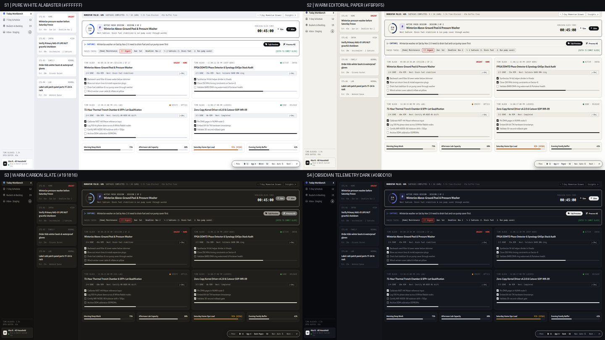
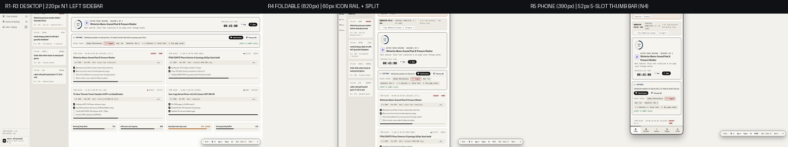

# `quiet-ui-skills` — Featuring *The Quiet UI Canvas* (17-Tier Anti-Slop Visual Architecture System v4.5)

> **Eliminate generic AI-generated layout slop, top-of-page KPI card bloat, and "pill/color soup" — while embracing Earned Expressiveness (`C3`), tactile corner control, and vector icon precision.**
> **`quiet-ui-skills`** equips coding agents (**Claude Code**, **Google Antigravity**, **Gemini CLI**, **Devin Desktop**, and **Cursor**) with a deterministic, 100% brand-free **17-Tier Graduated Visual Architecture System**, standalone CSS tokens ([`tokens/quiet-ui-tokens.css`](tokens/quiet-ui-tokens.css)), and **The Quiet UI Canvas** interactive showcase ([`quiet-ui-showcase.html`](quiet-ui-showcase.html) & [`docs/index.html`](docs/index.html)).

> [!TIP]
> ### 1-File Standalone Desktop Viewer ([`quiet-ui-showcase.html`](quiet-ui-showcase.html))
> Want to explore all **17 Mediums**, **4 Color Themes (`S1–S4`)**, **4 Densities (`D1–D4`)**, **5 Corner Stops (`0px`–`18px`)**, **3 Color Policies (`C1–C3`)**, and **5 Navigation Topologies (`N0–N4`)** offline?
> Download **[`quiet-ui-showcase.html`](quiet-ui-showcase.html)** (a 100% self-contained single HTML file with embedded assets, including the CC0 Claude Monet *Water Lilies* canvas) and double-click it on your desktop (`file:///`) in any browser—**zero build step, zero server, and zero external local file dependencies required.**


---

## Quickstart Installation

```bash
git clone https://github.com/FrankXLT/quiet-ui-skills.git
cd quiet-ui-skills
bash install.sh
```

- Installs `visual-architecture-system` into `~/.agents/skills/visual-architecture-system` and `~/.gemini/config/skills/visual-architecture-system` (or pass a custom path: `bash install.sh ./my-repo/.agents/skills/visual-architecture-system`).
- **Standalone CSS Tokens (Dual-Licensed MIT for Commercial Embedding):** Import [`tokens/quiet-ui-tokens.css`](tokens/quiet-ui-tokens.css) directly into any HTML, React, Vue, Svelte, or Home Assistant project:
  ```html
  <link rel="stylesheet" href="tokens/quiet-ui-tokens.css">
  ```
- **Live Interactive Showcase:** Open [`quiet-ui-showcase.html`](quiet-ui-showcase.html) (or [`docs/index.html`](docs/index.html)) directly in any browser or enable GitHub Pages on `/docs`.

---

## What's New in v4.5 (Earned Expressiveness, Clean Nav, Mermaid, Heroes, Monet Glass & `App-Tree`)

1. **Earned Expressiveness (`C3 · Modern Expressive`) & 3-Zone Envelope:** Keeps `>= 75%` of the canvas calm neutral (`S1–S4`), allows `<= 20%` soft surface tints (`--tint-indigo-bg`, `--tint-emerald-bg`, `--tint-amber-bg`, `--tint-rose-bg`, `--tint-violet-bg`) with **1 Single-Anchor Hero Card per view** + `34px×34px` `.va-icon-well` badges, and reserves `<= 5%` saturated signal ink for primary CTAs and live progress rings.
2. **5-Stop Corner Radius Dial (`data-corners="auto|sharp|subtle|rounded|soft"`):** Live control over `--radius-card` (`0px`, `6px`, `12px`, `18px`) while enforcing the **Interactive Affordance Pill Law** (buttons `.va-pill-btn`, segmented controls `.va-seg-pills`, and `.va-icon-well` remain tactile and rounded).
3. **Font Awesome 6 (`fa-solid`) Vector Icons, Borderless `.va-tab-link` & Hamburger Rail Collapse:** Replaces all unicode emojis with crisp vector icons, replaces boxy navbar buttons with borderless `.va-tab-link` / `.va-side-link`, strips SaaS account pods from Editorial tiers (`01`–`06`), and adds a working `.va-hamburger-btn` (`toggleLeftRailCollapse()`, `220px` $\leftrightarrow$ `60px` icon rail).
4. **Theme-Aware Mermaid Diagrams (`.va-mermaid-figure`) in `Doc-2`, `Doc-3`, and `Doc-4A`:** Styled with CSS theme variables and a 1-click `[Diagram | Mermaid Source]` toggle.
5. **Single-Anchor Hero Cards (`App-4` Focus Hero & `App-5` Readiness Ring Hero + Day Timeline) & Real Monet Glass (`HA-1`):** Authentic CC0 Claude Monet *Water Lilies (1906)* painting behind a true `backdrop-filter: blur(22px) saturate(145%)` frosted glass HUD on `15. HA-1`.
6. **New Tier `14. App-Tree` (Hierarchical Tree, Schema & File Explorer Workbench):** 3-pane coupled explorer (`260px` dual-mode `DB Schema` / `Repo Files` tree with `1px` `.va-tree-guide` indent guides + 3-tab `Data Grid` / `DDL & FK` / `SQL Console` workbench + `280px` column/node inspector).

---

## The 17-Tier Graduated Continuum (`0%` Box Weight $\rightarrow$ `100%` `1px` Grid $\rightarrow$ Workspaces $\rightarrow$ Spatial/Ambient)

| # | Tier ID | Structural Archetype | Box Weight | Default Theme | Default Nav | Primary Use Cases |
| :-: | :--- | :--- | :---: | :---: | :---: | :--- |
| `01` | **`Doc-1`** | Academic & Scientific Monograph | `0%` | `S2` Paper | `N1` | Whitepapers, mathematical derivations, research monographs |
| `02` | **`Doc-2`** | Executive Decision Memo (`BLUF` + Mermaid) | `15%` | `S2` Paper | `N0` | Board memos, architecture decision records, post-mortems |
| `03` | **`Doc-3`** | Normative RFC Specification (+ Mermaid FSM) | `25%` | `S1` White | `N0` | Protocol specs, RFCs, `MUST`/`SHALL` compliance audits |
| `04` | **`Doc-4B`** | Encyclopedic SDK & API Reference | `25%` | `S1` White | `N3` | Library SDK references, module/class/function dictionaries |
| `05` | **`Doc-4A`** | Split-Pane Operational Runbook (+ Mermaid Seq) | `45%` | `S1` White | `N1` | Deployment playbooks, incident response SOPs, tutorials |
| `06` | **`Bridge-1`** | Parametric Engineering Worksheet | `50%` | `S2` Paper | `N0` | Interactive trade studies, link-budget calculators, notebooks |
| `07` | **`Deck-1`** | Viewport-Locked Briefing Stage | `60%` | `S3` Dark Paper | `N1` | `100dvh` assertion-evidence briefings with zero page scroll |
| `08` | **`Bridge-2`** | High-Density Data Table & Status Grid (`1px` Grid) | `100% 1px Grid` | `S1` White | `N2` | High-density tabular ledgers, fleet audits, benchmark grids |
| `09` | **`App-2`** | Live Metrics & Time-Series Console | `100% 1px Grid` | `S4` Dark | `N1` | Multi-channel strip charts, timing analyzers, register matrices |
| `10` | **`App-1`** | Compact Issue & Ticket Tracker | `0% Cards (Rows)` | `S4` Dark | `N1` | `36px` single-line issue queues + live right inspector |
| `11` | **`App-4`** | Task & Calendar Planner (+ Focus Hero) | `80%` | `S1` White | `N1` | Active Focus Session Hero, 3-zone staging backlog, time blocks |
| `12` | **`App-3`** | KPI & Analytics Dashboard (Bento Grid) | `100% Cards` | `S4` Dark | `N2` | 12-col executive KPI & SLA health grid (4 layers per card) |
| `13` | **`App-5`** | Daily Pacing & Wellness Planner (+ Readiness Hero) | `75%` | `S2` Paper | `N1` | Readiness Ring Hero (`84 · Steady`), 24h Day Arc, vertical timeline |
| `14` | **`App-Tree`** | Hierarchical Tree, Schema & File Explorer | `90% 3-Pane` | `S4` Dark | `N1` | 3-pane coupled Schema/File tree (`1px` indent guides) + 3-tab workbench |
| `15` | **`HA-1`** | Ambient Wall Kiosk Screensaver (Monet + Glass) | `20% HUD` | `S4` Dark | `N0` | 10-foot `60/40` Claude Monet canvas + `blur(22px)` frosted glass HUD |
| `16` | **`HA-2`** | Room-First Wall Control Panel | `85%` | `S2` Paper | `N1` | Walk-up room cards (`<= 4` metrics/room, `.va-icon-well`) + fixture dock |
| `17` | **`HA-3`** | Crease-Aware Foldable & Phone Controller | `85%` | `S4` Dark | `N4` | `56px` full-row slider tiles, `820px` 50/50 fold split & `390px` thumb bar |


---

## Visual Proof Gallery

### 1. Color Theme (`S1–S4`), Earned Expressiveness (`C1–C3`) & 5-Stop Corner Radius Dial



### 2. Task & Calendar Planner (`11. App-4`) & Daily Pacing & Wellness Planner (`13. App-5`)

| `11. App-4` · Task & Calendar Planner (+ Focus Hero) | `13. App-5` · Daily Pacing & Wellness Planner (+ Readiness Hero) |
| :---: | :---: |
|  |  |

### 3. Progressive-Disclosure Home Assistant Architecture (`15. HA-1` Monet Glass, `16. HA-2`, `17. HA-3`)


### 4. Responsive Navigation (`R1–R3` Desktop $\rightarrow$ `R4` `820px` Foldable Icon Rail $\rightarrow$ `R5` `390px` Phone Bottom Dock)



| Unfolded Foldable (`R4 · 820px` Across All 17 Tiers) | Portrait Phone Handset (`R5 · 390px` Across All 17 Tiers) |
| :---: | :---: |
|  |  |

---

## Automated Visual Contract & Zero-PII Verifier

```bash
python3 skills/visual-architecture-system/scripts/verify_visual_contract.py quiet-ui-showcase.html --tier ALL
python3 skills/visual-architecture-system/scripts/verify_visual_contract.py docs/index.html --tier ALL
```

---

## License & Commercial Output Exemption (`GNU AGPLv3` + `NOTICE`)

This repository is licensed under the **GNU Affero General Public License v3.0 ([`LICENSE`](LICENSE))** with **AGPLv3 Section 7 Additional Terms & Commercial Output Exemption ([`NOTICE`](NOTICE))**:

1. **Unconditional Commercial UI Output Exemption:** Any HTML, CSS, web applications, dashboards, slide decks, or documents generated *using* `quiet-ui-skills`—including embedding [`tokens/quiet-ui-tokens.css`](tokens/quiet-ui-tokens.css) (which is dual-licensed under the **MIT License** for runtime embedding) into proprietary or commercial software—belong 100% to you and may be distributed or sold commercially without restriction.
2. **No Standalone Skill Repackaging or Paid Skill Marketplaces:** You may not repackage, rebrand, or sell `quiet-ui-skills` itself (`SKILL.md`, `references/`, `verify_visual_contract.py`, or `quiet-ui-showcase.html`) as a paid standalone agent skill or prompt pack.
3. **Mandatory Upstream Link & Fork Attribution (`AGPLv3 §7(b)–(c) & §5(a)`):** Any modified version or redistribution of the skill must retain [`NOTICE`](NOTICE), clearly date all modifications, and link back to the canonical upstream repository (`https://github.com/FrankXLT/quiet-ui-skills`).

