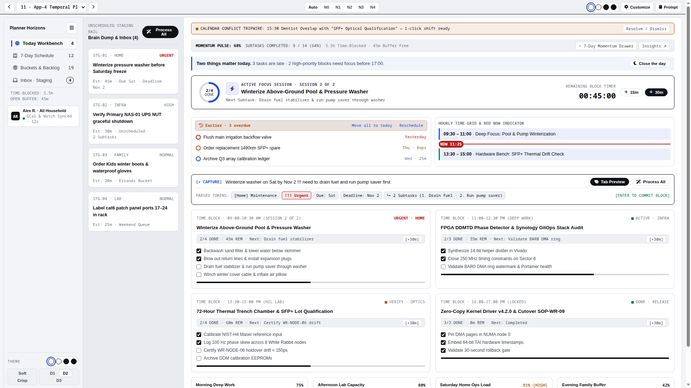
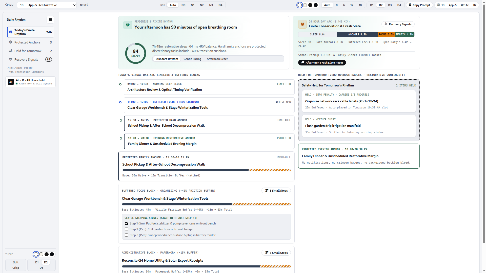
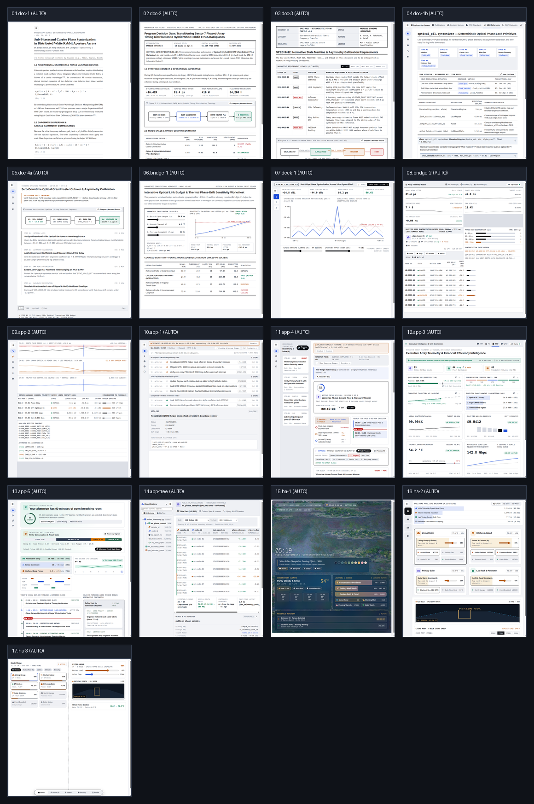
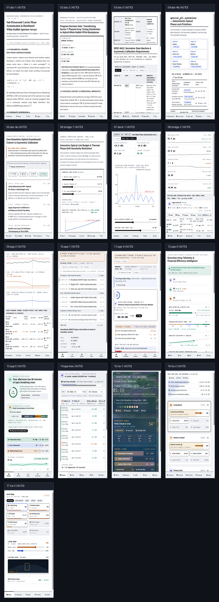

# `quiet-ui-skills` — Featuring *The Quiet UI Canvas* (17-Tier Anti-Slop Visual Architecture System v6.0)

> **Eliminate generic AI-generated layout slop, top-of-page KPI card bloat, random font/size drift across pages, and "pill/color soup" — while embracing a Compiler-Grade Agent Architecture (`v6.0` Pre-Edit Output Contract & Content-Only Lock), Concentric Border-Radius Math ($R_{\text{inner}} = \max(0, R_{\text{outer}} - \text{Inset})$), Unified Suite Typography & 7-Step Modular Scale (`--ts-xs: 11px` Hard Floor .. `--ts-display: 24px–28px`, `<= 4` sizes/card, `0px` Nav Drift), 6 Mathematical Alignment Invariants, Universal Pure White (`S1`) Default legibility, and Earned Expressiveness (`C3`).**
> **`quiet-ui-skills`** equips coding agents (**Claude Code**, **Google Antigravity**, **Gemini CLI**, **Devin Desktop**, and **Cursor**) with a deterministic, 100% brand-free **17-Tier Graduated Visual Architecture System**, standalone CSS tokens ([`tokens/quiet-ui-tokens.css`](tokens/quiet-ui-tokens.css)), machine-readable [`llms.txt`](llms.txt), and **The Quiet UI Canvas** interactive showcase ([`quiet-ui-showcase.html`](quiet-ui-showcase.html) & [`docs/index.html`](docs/index.html)).

> [!TIP]
> ### 1-File Standalone Desktop Viewer ([`quiet-ui-showcase.html`](quiet-ui-showcase.html)) & Shareable URL Deep Links
> Explore all **17 Mediums**, **4 Color Themes (`S1–S4`)**, **4 Densities (`D1–D4`)**, **5 Concentric Corner Stops (`0px`–`18px`)**, **3 Color Policies (`C1–C3`)**, and **5 Navigation Topologies (`N0–N4`)** offline or via deep-linked URL query parameters (`?tier=app-4&nav=n1&theme=white&density=d2&corners=rounded`).
> Download **[`quiet-ui-showcase.html`](quiet-ui-showcase.html)** (100% self-contained single HTML file with embedded CC0 Claude Monet *Water Lilies* canvas) and open it directly in any browser—**zero build step, zero server, and zero external local file dependencies required.**


---

## Quickstart Installation

```bash
git clone https://github.com/FrankXLT/quiet-ui-skills.git
cd quiet-ui-skills
bash install.sh
```

- Installs `visual-architecture-system` (`v6.0` `SKILL.md`, `references/00..06`, `scripts/verify_visual_contract.py`, and `tokens/quiet-ui-tokens.css`) into `~/.agents/skills/visual-architecture-system` and `~/.gemini/config/skills/visual-architecture-system` (or pass a custom path: `bash install.sh ./my-repo/.agents/skills/visual-architecture-system`).
- **Standalone CSS Tokens (Dual-Licensed MIT for Commercial Embedding):**
  ```html
  <link rel="stylesheet" href="tokens/quiet-ui-tokens.css">
  ```

---

## Which Tier Should I Use? (Autonomous Situation $\rightarrow$ Tier Router)

When you ask an agent to *"make this look better"* or pass raw markdown, JSON, SQL, or container/task data without naming a tier, the **v6.0 Autonomous Content-to-UI Compiler (`Mode M3`)** inspects your content shape and compiles it into the right medium and component blocks:

| Your Situation / Input Data Shape | Auto-Selected Tier & Nav | Signature Component Blocks Compiled Automatically |
| :--- | :--- | :--- |
| **Long-Form Essay, Whitepaper, or Math Proof** | `01. Doc-1` (`N1` + `S1`) | `68ch` prose column (`16.5px`), `.doc1-mobile-toc-bar` (`0px` left-axis drift), Booktabs tables |
| **Architecture Decision Memo or Post-Mortem** | `02. Doc-2` (`N0` + `S1`) | Top `BLUF` Decision Box, Option Trade Matrix, Mermaid topology diagram |
| **Normative RFC or Security Compliance Spec** | `03. Doc-3` (`N0` + `S1`) | `MUST`/`SHALL` filterable requirement strip, Mermaid state machine |
| **Skill Repo, CLI Tool, SDK, or API Reference** | `04. Doc-4B` (`N3` + `S1`) | **6-Stage Flow Spine (`.va-flow-spine`)**, `/slash` pills, **Situation $\rightarrow$ Action Router Table** |
| **Deployment SOP or Incident Playbook** | `05. Doc-4A` (`N1` + `S1`) | `55/45` split narrative + sticky multi-tab code pane (`28px` edge collapse tab) |
| **Container Fleet, Node Inventory, or Quota Telemetry** | `08. Bridge-2` / `12. App-3` (`N2`) | **Scoped Context Box (`.va-scoped-nav-box`)**, **3-Zone Fleet Cards (`.va-fleet-card-3zone`)**, **Bulk Action Bar (`.va-bulk-action-bar`)**, **Expected-Pace Bar (`.va-pace-bar`)**, **Trajectory Curve (`.va-trajectory-chart`)** |
| **Daily Tasks, Planner, or Biometric Pacing** | `11. App-4` / `13. App-5` (`N1`) | **1-Sentence Briefing (`.va-status-briefing`)**, **Priority Rings (`.va-priority-ring`)**, **Time-Grid Blocks (`.va-timegrid-block`)**, **Self-Filling Capsules (`.va-fill-capsule`)**, **Corridor Sparklines (`.va-corridor-sparkline`)** |
| **DB Schema, File Tree, or Log Stream** | `14. App-Tree` / `10. App-1` (`N1`) | 3-pane coupled Schema/File explorer (`228px–260px` labeled tree, `.va-th-title` aligned headers), `Key \| Value` chips |
| **Smart Home Wall Kiosk or Mobile Companion** | `15. HA-1` .. `17. HA-3` (`N0/N1/N4`) | `60/40` Monet glass HUD (`HA-1`), room cards + `.va-prop-bar-row` circuit load (`HA-2`), `820px` fold / `390px` thumb dock (`HA-3`) |

---

## What's New in v6.0 (Compiler-Grade Agent Architecture, Concentric Radius Math, 7-Step Typography & `--check-docs` Linter)

1. **Compiler-Grade Agent Architecture & Progressive-Disclosure Routing (`v6.0`):**
   - **Pre-Edit 4-Field Output Contract (`Execution Mode`, `Target Tier & Nav`, `Surface & Density`, `Verification Gate`)** + **Content-Only Preservation Lock** (preserving 100% of existing CSS/layout when updating copy or rows) + **Atomic Staging Rule** + **Progressive-Disclosure Routing Table** (`Read ONLY when...` triggers for `references/00..06.md`).
   - **`--check-docs` Reference Snippet Token Linter & LLM Generation-Failure Linter:** Automatically verifies that 100% of `var(--...)` custom properties in markdown code blocks exist in `tokens/quiet-ui-tokens.css`, all `references/*.md` files are linked in `SKILL.md`, and rendered DOM has `0` leaked markdown syntax (`**`, `## `), `0` unfilled placeholders (`TODO`, `TBD`, `Lorem ipsum`), and `<= 4` consecutive identical cards.
2. **Concentric Nested Border-Radius Math ($R_{\text{inner}} = \max(0, R_{\text{outer}} - \text{Inset})$) & Per-View 4-Size Restraint:**
   - Nested sub-cards, `.va-icon-well`, segmented trough buttons, and `.va-fill-capsule` derive concentric inner radii via `--inset-pad: 4px`, `--radius-inner: max(0px, calc(var(--radius-card, 8px) - var(--inset-pad, 4px)))`, and `--radius-trough-pill: max(0px, calc(var(--radius-sm, 6px) - 2px))` across all 5 corner stops.
   - Each card/panel budgets at most **4 active font sizes** and **2 primary text contrast rungs** (`--text-primary` and `--text-secondary`).
3. **Unified Suite Typography & 7-Step Modular Scale (`--ts-xs: 11px` Hard Floor .. `--ts-display: 24px–28px`, `0px` Nav Drift):**
   - `--font-sans` (`Inter`) governs 100% of navigation (`13px`), kickers (`11px`), headings (`Doc-2`..`HA-3`), controls, and app copy; `--font-serif` (`Newsreader`) is reserved strictly for `01. Doc-1` & `13. App-5` narrative prose; `--font-mono` (`JetBrains Mono`) is reserved strictly for machine literals.
4. **6 Mathematical Alignment Invariants (`v5.0`) + Fitbit & Monarch Telemetry (`v4.9`) + AI Hero, Portainer & OpenTodo Archetypes (`v4.8`).**

---

## The 17-Tier Graduated Continuum (Universal `S1` Pure White Default $\rightarrow$ Live 4-Theme Switching)

| # | Tier ID | Structural Archetype | Box Weight | Default Theme | Default Nav | Primary Use Cases |
| :-: | :--- | :--- | :---: | :---: | :---: | :--- |
| `01` | **`Doc-1`** | Academic & Scientific Monograph | `0%` | `S1` White | `N1` | Whitepapers, mathematical derivations, research monographs |
| `02` | **`Doc-2`** | Executive Decision Memo (`BLUF` + Mermaid) | `15%` | `S1` White | `N0` | Board memos, architecture decision records, post-mortems |
| `03` | **`Doc-3`** | Normative RFC Specification (+ Mermaid FSM) | `25%` | `S1` White | `N0` | Protocol specs, RFCs, `MUST`/`SHALL` compliance audits |
| `04` | **`Doc-4B`** | Encyclopedic SDK & API Reference (+ Flow Spine) | `25%` | `S1` White | `N3` | Library SDK references, CLI/Skill docs, Situation $\rightarrow$ Action tables |
| `05` | **`Doc-4A`** | Split-Pane Operational Runbook (+ Mermaid Seq) | `45%` | `S1` White | `N1` | Deployment playbooks, incident response SOPs, tutorials |
| `06` | **`Bridge-1`** | Parametric Engineering Worksheet | `50%` | `S1` White | `N0` | Interactive trade studies, link-budget calculators, notebooks |
| `07` | **`Deck-1`** | Viewport-Locked Briefing Stage | `60%` | `S1` White | `N1` | `100dvh` assertion-evidence briefings with zero page scroll |
| `08` | **`Bridge-2`** | High-Density Data Table & Fleet Grid (`1px` Grid) | `100% 1px Grid` | `S1` White | `N2` | Fleet inventories, bulk-action container tables, benchmark grids |
| `09` | **`App-2`** | Live Metrics & Time-Series Console | `100% 1px Grid` | `S1` White | `N1` | Multi-channel strip charts, timing analyzers, register matrices |
| `10` | **`App-1`** | Compact Issue & Ticket Tracker | `0% Cards (Rows)` | `S1` White | `N1` | `36px` single-line issue queues + live right inspector |
| `11` | **`App-4`** | Task & Calendar Planner (+ Focus Hero & Briefing) | `80%` | `S1` White | `N1` | 1-sentence briefing, priority-ring tasks, Focus Hero, time-grid blocks |
| `12` | **`App-3`** | KPI & Fleet Analytics Dashboard (Bento Grid) | `100% Cards` | `S1` White | `N2` | 12-col executive KPI & 2×3 icon-well fleet summary grid |
| `13` | **`App-5`** | Daily Pacing & Wellness Planner (+ Readiness Hero) | `75%` | `S1` White | `N1` | Readiness Ring Hero (`84 · Steady`), 24h Day Arc, time-grid blocks |
| `14` | **`App-Tree`** | Hierarchical Tree, Schema & File Explorer | `90% 3-Pane` | `S1` White | `N1` | 3-pane coupled Schema/File tree (`1px` indent guides) + 3-tab workbench |
| `15` | **`HA-1`** | Ambient Wall Kiosk Screensaver (Monet + Light Glass) | `20% HUD` | `S1` White | `N0` | 10-foot `60/40` Claude Monet canvas + `blur(22px)` frosted glass HUD |
| `16` | **`HA-2`** | Room-First Wall Control Panel | `85%` | `S1` White | `N1` | Walk-up room cards (`<= 4` metrics/room, `.va-icon-well`) + fixture dock |
| `17` | **`HA-3`** | Crease-Aware Foldable & Phone Controller | `85%` | `S1` White | `N4` | `56px` full-row slider tiles, `820px` 50/50 fold split & `390px` thumb bar |


---

## Visual Proof Gallery

| `11. App-4` · Task & Calendar Planner (+ Focus Hero) | `13. App-5` · Daily Pacing & Wellness Planner (+ Readiness Hero) |
| :---: | :---: |
|  |  |

| Unfolded Foldable (`R4 · 900px` Across All 17 Tiers) | Portrait Phone Handset (`R5 · 390px` Across All 17 Tiers) |
| :---: | :---: |
|  |  |

---

## Automated Visual Contract & Zero-PII Verifier

```bash
python3 skills/visual-architecture-system/scripts/verify_visual_contract.py quiet-ui-showcase.html --tier ALL
python3 skills/visual-architecture-system/scripts/verify_visual_contract.py docs/index.html --tier ALL
```

---

## License & Commercial Output Exemption (`GNU AGPLv3` + `NOTICE`)

Licensed under the **GNU Affero General Public License v3.0 ([`LICENSE`](LICENSE))** with **AGPLv3 Section 7 Commercial Output Exemption ([`NOTICE`](NOTICE))**: any HTML, CSS, web apps, dashboards, slide decks, or documents generated *using* `quiet-ui-skills` (including embedding [`tokens/quiet-ui-tokens.css`](tokens/quiet-ui-tokens.css), dual-licensed under **MIT**) belong 100% to you for unrestricted commercial distribution.
