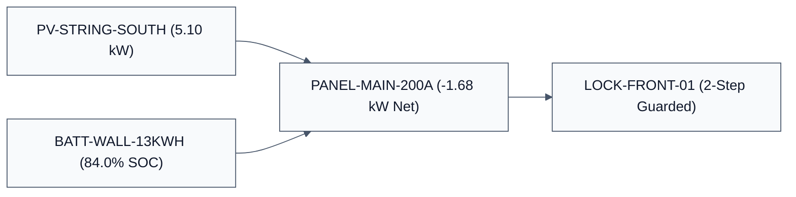

# 5-Ecosystem Visualization Adapter Guide

Quiet Evidence metrology standards are **renderer-agnostic**. Use the deterministic
first-party Python SVG compiler for archival print (`M1`), schemas/bitfields/waveforms
(`M3`/`M5`/`M6`), and zero-JS standalone delivery, or translate the exact same Quiet UI
rules into **Apache ECharts**, **Plotly**, **Matplotlib**, **Bokeh**, or **Mermaid**.

---

## 1. Non-Negotiable Metrological Invariants Across All Backends

Regardless of which library renders the pixels, every chart emitted inside a Quiet UI
surface **MUST** preserve these five guarantees:

1. **Dynamic Token Binding**: Read CSS custom properties (`--text-primary`,
   `--text-secondary`, `--accent-focal`, `--status-warn`, `--status-danger`,
   `--border-hairline`) rather than hardcoding static colors so theme switches
   (`white`, `paper`, `dark`, `dark-paper`) stay WCAG-compliant.
2. **NIST SP 811 Quantity Calculus Labels**: Label axes strictly as `Symbol / Unit` or
   `Quantity, Symbol / Unit` (for example `P_grid / kW` or `η_bte / %`).
3. **Explicit Epistemic Separation**: Render discrete measurements as markers (`+/- u_y`
   error whiskers) and theoretical/empirical regressions as distinct dashed curves;
   never smooth away sparse test points with splines.
4. **Honest Dropout Handling**: Preserve `null` / `NaN` gaps as broken segments rather than
   interpolating across missing samples.
5. **Ceiling/Floor Envelopes & Safe Label Clamping**: Keep threshold reference lines
   inside plot margins with overlap guards (`hideOverlap: true`, bounded labels).

---

## 2. Apache ECharts (`renderer: 'svg'`)

Prefer the `'svg'` renderer for crisp scaling and CSS token integration. Read root CSS
tokens before invoking `chart.setOption(option)` and re-run on theme switches.

```javascript
function quietCssVar(name, fallback) {
  const value = getComputedStyle(document.documentElement).getPropertyValue(name).trim();
  return value || fallback;
}

function buildQuietEChartsOption(seriesData, limitKw) {
  const ink = quietCssVar('--text-primary', '#0F172A');
  const muted = quietCssVar('--text-secondary', '#475569');
  const accent = quietCssVar('--accent-focal', '#0369A1');
  const warn = quietCssVar('--status-warn', '#B45309');
  const gridLine = quietCssVar('--border-hairline', '#E2E8F0');

  return {
    animation: false,
    backgroundColor: 'transparent',
    tooltip: { trigger: 'axis', confine: true },
    grid: { left: 66, right: 24, top: 42, bottom: 52, containLabel: true },
    xAxis: {
      type: 'value',
      name: 'Local Time, t / h',
      nameLocation: 'middle',
      nameGap: 28,
      axisLabel: { color: muted, fontSize: 11, hideOverlap: true },
      splitLine: { lineStyle: { color: gridLine, type: 'dashed' } },
    },
    yAxis: {
      type: 'value',
      name: 'Active Power, P / kW',
      nameLocation: 'middle',
      nameGap: 44,
      axisLabel: { color: muted, fontSize: 11, hideOverlap: true },
      splitLine: { lineStyle: { color: gridLine, type: 'dashed' } },
    },
    series: [{
      name: 'Measured Power (+/- u_y)',
      type: 'line',
      connectNulls: false,
      symbol: 'circle',
      symbolSize: 6,
      itemStyle: { color: accent },
      lineStyle: { color: accent, width: 2 },
      textStyle: { color: ink },
      data: seriesData,
      markLine: {
        silent: true,
        symbol: ['none', 'none'],
        label: { position: 'insideEndTop', color: warn, fontSize: 10.5 },
        lineStyle: { color: warn, type: 'dashed', width: 1.5 },
        data: [{ name: 'Peak Tariff', yAxis: limitKw }],
      },
    }],
  };
}
```

---

## 3. Plotly (`plotly.graph_objects`)

Use `go.Scatter` with explicit `error_y`, `connectgaps=False`, crisp straight segments,
and `fig.add_hline` for operating corridors.

```python
import plotly.graph_objects as go


def make_quiet_plotly_figure(x, y_meas, u_y, x_model, y_model, ceiling_val, dark=False):
    fg = "#F8FAFC" if dark else "#0F172A"
    accent = "#38BDF8" if dark else "#0369A1"
    warn = "#FBBF24" if dark else "#B45309"

    fig = go.Figure()
    fig.add_trace(
        go.Scatter(
            x=x_model,
            y=y_model,
            mode="lines",
            name="Analytical Model",
            line={"color": "#94A3B8", "width": 1.8, "dash": "dash"},
        )
    )
    fig.add_trace(
        go.Scatter(
            x=x,
            y=y_meas,
            mode="markers+lines",
            name="Discrete Measurement (+/- u_y)",
            connectgaps=False,
            marker={"color": accent, "size": 6},
            line={"color": accent, "width": 2},
            error_y={"type": "data", "array": u_y, "visible": True, "thickness": 1.2},
        )
    )
    fig.add_hline(y=ceiling_val, line_dash="dashdot", line_color=warn, annotation_text="Ceiling")
    fig.update_layout(
        template="plotly_dark" if dark else "plotly_white",
        paper_bgcolor="rgba(0,0,0,0)",
        plot_bgcolor="rgba(0,0,0,0)",
        font={"color": fg},
        xaxis_title="Local Time, t / h",
        yaxis_title="Active Power, P / kW",
        margin={"l": 64, "r": 24, "t": 40, "b": 48},
    )
    return fig
```

---

## 4. Matplotlib (`M1` Archival Vector & Print Publications)

Match `M1` archival monographs by despine-trimming top/right rules, preserving discrete
errorbars vs. dashed model curves, and enforcing exact vector SVG/PDF export.

```python
import matplotlib.pyplot as plt


def render_quiet_matplotlib(x, y_meas, u_y, x_model, y_model, limit_val, out_svg):
    fig, ax = plt.subplots(figsize=(6.4, 3.6), constrained_layout=True)
    ax.plot(x_model, y_model, linestyle="--", linewidth=1.4, color="#475569", label="Analytical Model")
    ax.errorbar(
        x,
        y_meas,
        yerr=u_y,
        fmt="o-",
        markersize=4.5,
        linewidth=1.5,
        capsize=3,
        color="#0369A1",
        label="Measured (+/- u_y)",
    )
    ax.axhline(limit_val, linestyle="-.", linewidth=1.2, color="#B45309", label="Operating Limit")
    ax.spines[["top", "right"]].set_visible(False)
    ax.grid(axis="y", linestyle=":", linewidth=0.7, alpha=0.5)
    ax.set(xlabel="IMEP / bar", ylabel="eta_bte / %")
    ax.legend(frameon=False, fontsize=9)
    fig.savefig(out_svg, format="svg", transparent=True)
    plt.close(fig)
```

---

## 5. Bokeh (`bokeh.plotting` + `Whisker`)

When delivering interactive Python notebooks or server dashboards via Bokeh, bind
`ColumnDataSource` uncertainty intervals explicitly with `Whisker` annotations and
`Span` reference thresholds.

```python
from bokeh.models import ColumnDataSource, Span, Whisker
from bokeh.plotting import figure


def make_quiet_bokeh_figure(x, y, u_y, threshold):
    lower = [val - err if val is not None else None for val, err in zip(y, u_y)]
    upper = [val + err if val is not None else None for val, err in zip(y, u_y)]
    source = ColumnDataSource({"x": x, "y": y, "lower": lower, "upper": upper})

    p = figure(height=320, sizing_mode="stretch_width", toolbar_location="above")
    p.line("x", "y", source=source, line_width=2, color="#0369A1")
    p.scatter("x", "y", source=source, size=6, color="#0369A1")
    p.add_layout(Whisker(base="x", lower="lower", upper="upper", source=source, line_color="#0369A1"))
    p.add_layout(Span(location=threshold, dimension="width", line_color="#B45309", line_dash="dashed"))
    p.xaxis.axis_label = "Local Time, t / h"
    p.yaxis.axis_label = "Active Power, P / kW"
    p.outline_line_color = None
    return p
```

---

## 6. Mermaid (`%%{init: ...}%%` Neutral Quiet Theme)

For architectural diagrams outside native Quiet Evidence AST blocks, suppress Mermaid
defaults with neutral base tokens (`#F8FAFC` surfaces, `#0F172A` borders/ink, zero glow):



For multi-day schedules (`plot_kind: "gantt"`), prefer native Mermaid `gantt` syntax with critical-path markers (`crit`) and milestones (`milestone`), while ECharts `QuietEChartsExt` renders `gantt`, `heatmap`, `dumbbell`, and `forest` onto `'svg'` hosts reading `--text-primary`, `--accent-focal`, and `--status-warn` at runtime:

```mermaid
gantt
    title Release Cutover Schedule
    dateFormat X
    axisFormat %s
    section Execution
    API Freeze       :crit, t1, 0, 4
    Integration QA   :t2, 4, 8
    GA Milestone     :milestone, m1, 10, 10
```



---

## 7. Browser-Side Dynamic SVG Layout (`window.QuietSvgLayout`) & ECharts Safe Defaults

When interactive dashboards synthesize live `<svg>` charts in browser JavaScript (rather than pre-compiling static specs through Python), route axis ticks, category gutters, word wrapping, and reference lines through **`window.QuietSvgLayout`** (automatically bundled into `quiet-evidence-bundle.js`):

```javascript
const {
  niceScale125, sharedNiceScale125, buildCanonicalTimeGrid,
  computeGridFrameGutters, wrapLabelLines, measureCategoryGutter,
  filterNonOverlappingTicks, placeReferenceLabel,
} = window.QuietSvgLayout;

// 1. Canonical zero-filled X buckets & shared 1-2-5 Y bounds across peer cohorts
const buckets = buildCanonicalTimeGrid(tMinMs, tMaxMs, stepMs);
const yShared = sharedNiceScale125([cohortASeries, cohortBSeries], { targetTicks: 5, headroomRatio: 0.06 });

// 2. Column/row/2D pixel registration (containLabel: false locks [x_left, x_right] & [y_top, y_bottom])
const gutters = computeGridFrameGutters([[topLeftDesc, topRightDesc], [botLeftDesc, botRightDesc]]);
const gutter = measureCategoryGutter(rawLabels, { minPx: 68, maxPx: 176, maxChars: 20 });
const cats = wrapLabelLines("Primary Model Cohort (Long Run)", 20, 2);
const visibleXTicks = filterNonOverlappingTicks(rawTicks, { axis: 'x', minGapPx: 12, keepEnds: true });

// 3. Draw Avg / Ceiling reference labels with opaque background + paint-order stroke halo
placeReferenceLabel(svgEl, {
  text: "Ceiling 120",
  x: plotRight - 6,
  y: ceilingY - 5,
  anchor: "end",
  plotX0, plotX1: plotRight, plotY0, plotY1: plotBottom,
  haloColor: "var(--bg-surface)",
});
```

### ECharts Guardrails (`QuietEChartsDefaults` & Multi-Plot Spine Registration)
- For standalone single charts, `normalizeOption` enforces `grid: { containLabel: true }`, haloed inside `markLine.label` (`padding: [2, 5]`), and `1-2-5` `yAxis.max` padding.
- Route single-chart options through `QuietEChartsDefaults.normalizeOption(opt, payload, tokens, containerWidth)` (`applySafeLegendLayout`):
  - **Narrow `390px` Scroll-Legend Guard**: Converts `< 640px` or unopted `type: 'scroll'` legends into wrapping `'plain'` at `bottom: 0` so paginator arrows never overlap text.
  - **Dual Right-Hand Y-Axis Legend Guard**: Anchors legends on right-axis plots to `bottom: 0` (`left: 'center'`) with `grid.bottom >= 38` (`>= 46` narrow `>= 3` items).
- **Multi-Plot Columns, Rows & `R x C` Grids (`alignPlotGridFrames` / `alignSharedAxes`)**: Leaving `containLabel: true` across stacked or side-by-side ECharts plots causes varying inner shifts (`"6M"` vs. `"3.5M"` or right Y-axes). Pass `[p0, p1]` or `[[r0c0, r0c1], [r1c0, r1c1]]` to `QuietEChartsDefaults.alignPlotGridFrames(matrix, opts)` (or `alignSharedAxes(list, opts)` for column stacks):
  - Pre-measures left/right Y ticks, axis titles, and legend clearances, then writes explicit column-max `left`/`right` and row-max `top`/`bottom` pixel gutters with `containLabel: false` (`<= 2px` `[PLOT_AXIS_MISALIGN]` spine registration).
  - Re-indexes sparse category series onto canonical zero-filled X buckets down matching `(col, xUnit, eventKey)` columns while letting differing `xUnit`/`eventKey` (`independentXSpan`) or differing `yUnit` (`independentYSpan` / `quietZoomedScale`) retain independent domain spans.
  - Pair side-by-side cards with `.va-plot-row` / `.va-plot-grid` CSS `subgrid` so uneven 1- vs. 2-line headers never shift adjacent `<svg>` stages vertically.
- **Responsive `ResizeObserver` & Cohesive Palette (`observeChartResize` + `--chart-1..5`)**: Attach `QuietEChartsDefaults.observeChartResize(hostEl, chart)` (with `requestAnimationFrame` debounce and cleanup returned for unmount/`disposeWrap`) alongside `min-width: 0; max-width: 100%;` on `.va-card`, `.va-pane`, `.qe-plot-wrap`, and `.qe-echarts-host` so half-screen (`~720px`) snaps and vertical tab bars never freeze chart widths. Draw all series page-wide from the unified `--chart-1..5` ramp.
